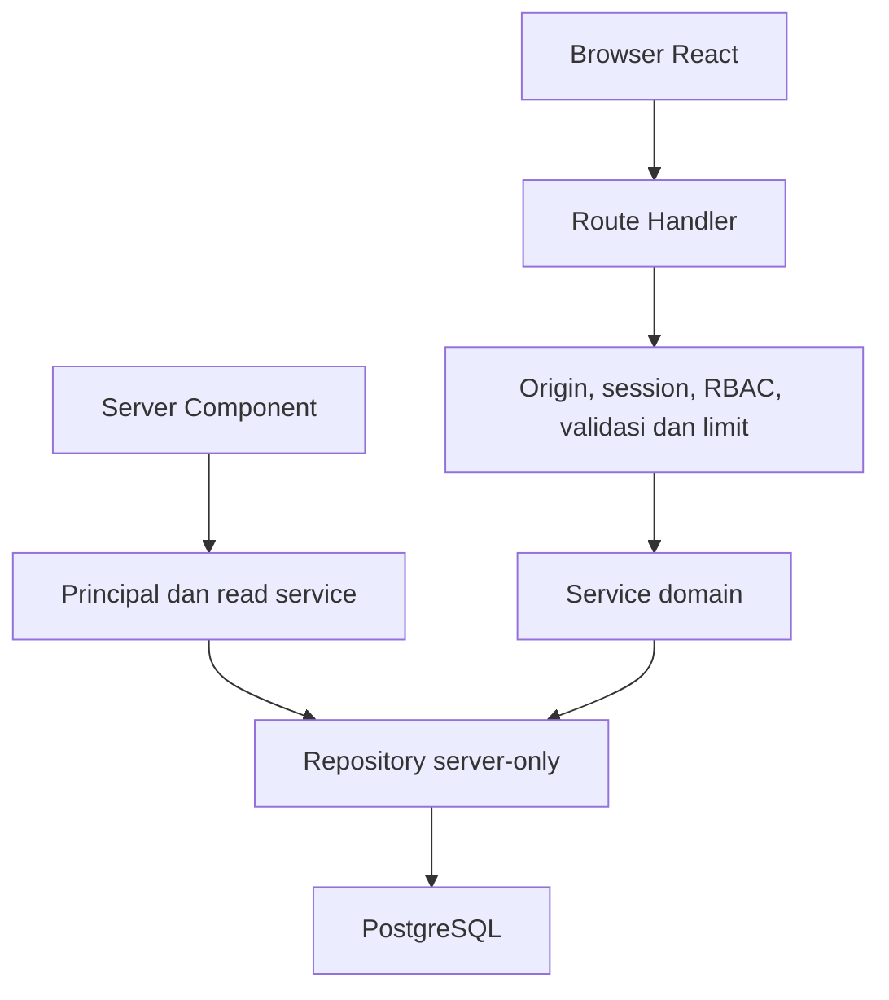
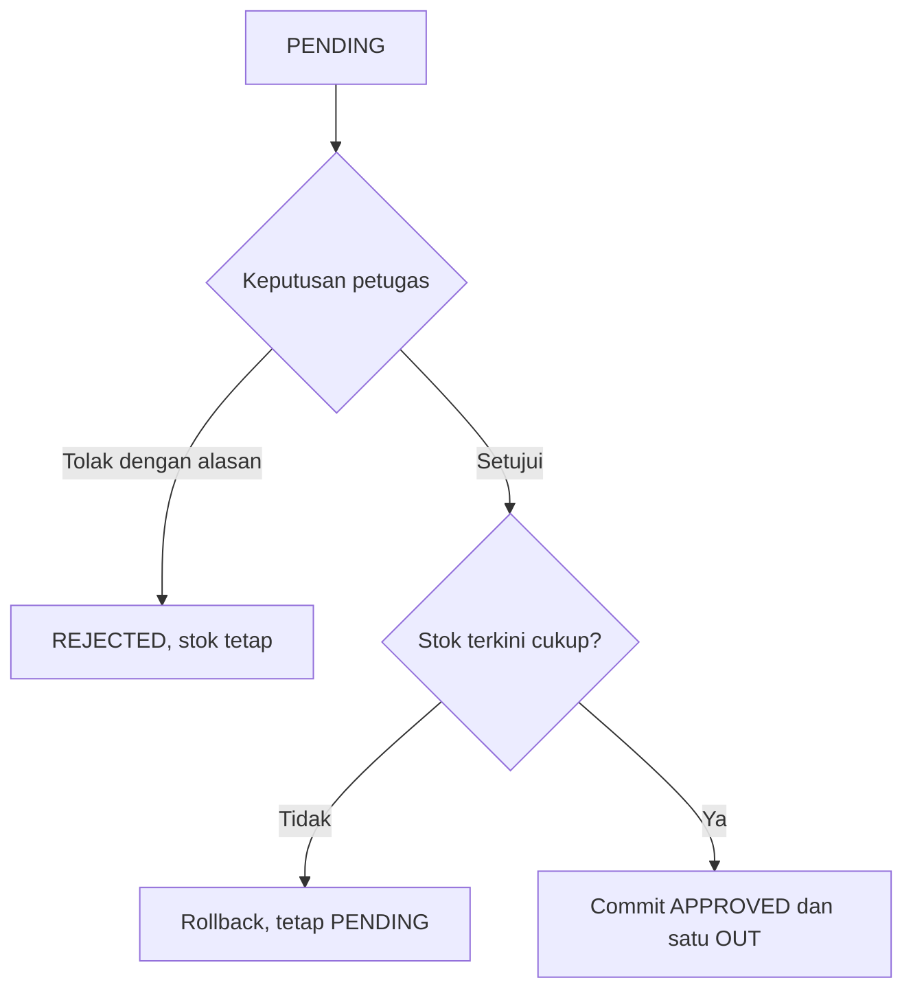

# PRD — Warehouse Office Supplies

Versi 1.0 | 26 November 2026 | Status: siap menjadi acuan implementasi, belum diimplementasikan.

## 1. Tujuan dan sumber kebutuhan

Membuat aplikasi web satu gudang perlengkapan kantor. Karyawan mengetahui barang dan stok yang tersedia; petugas mencatat penerimaan serta menyetujui/menolak permintaan dengan saldo yang konsisten.

Sumber utama: `PAPI - Tes 26112026.pdf`, dikirim 26 November 2026, deadline 28 November 2026 pukul 23.59 WIB. Soal membebaskan bahasa, framework, database, antarmuka, dan deployment. Microservices bukan persyaratan eksplisit PDF. Mention pada lowongan menjadi konteks arsitektur, bukan dasar mengganti kebutuhan tes.

Keberhasilan: seluruh alur wajib berjalan dari browser, backend menegakkan akses, data persisten, stok tidak negatif, dan satu permintaan hanya mengurangi stok satu kali walaupun request diulang atau datang bersamaan.

## 2. Scope dan prioritas

| ID | Fitur | Prioritas | Asal |
| --- | --- | --- | --- |
| F01 | Login/logout dua role operasional | P0 | Wajib soal |
| F02 | Katalog: kode, nama, satuan, lokasi, stok; barang baru nol | P0 | Wajib soal |
| F03 | Tambah/edit detail barang oleh petugas | P0 | Wajib soal |
| F04 | Penerimaan jumlah positif menambah stok | P0 | Wajib soal |
| F05 | Riwayat masuk/keluar: tanggal, jumlah, saldo setelah transaksi | P0 | Wajib soal |
| F06 | Permintaan satu barang, status Menunggu, riwayat milik sendiri | P0 | Wajib soal |
| F07 | Approval/rejection; validasi stok terbaru; pengurangan satu kali | P0 | Wajib soal |
| F08 | RBAC backend, ownership, validasi, persistensi | P0 | Wajib soal |
| F09 | Session revocable, CSRF/origin checks, rate limit persisten | P0 | Kualitas implementasi / arahan user |
| F10 | Role superadmin, daftar akun, perubahan role/status, revoke sessions | P1 | Tambahan terbatas |
| F11 | Nomor transaksi, search/filter/pagination, alasan penolakan | P1 | Usulan MVP |
| F12 | Asal barang dan referensi surat jalan pada penerimaan | P1 | Tambahan yang dibahas |

P0 harus selesai sebelum memperindah dashboard atau memperluas P1. Tiga role disediakan melalui seed; operasi superadmin ditambahkan setelah alur wajib aman. Batas MVP tidak berubah hanya karena framework menyediakan plugin tambahan.

Di luar MVP: public signup, account creation UI, password reset email, OAuth, MFA, permission builder, pengadaan/PO/invoice, supplier master, lampiran file, penerimaan multi-item, multi-gudang, reservasi, partial approval, serah-terima terpisah, retur, opname, adjustment, barcode, konversi satuan, websocket, queue dan microservices. Akun tambahan disediakan melalui CLI operator; bukan endpoint signup publik.

## 3. Stack dan struktur

Next.js App Router + React + TypeScript strict; Tailwind + shadcn/ui; PostgreSQL 17; Prisma 7 dan adapter PostgreSQL; Better Auth database sessions; Zod; Vitest dan Playwright. Gunakan Node runtime, bukan Edge, untuk modul auth/database.

Versi exact diselesaikan di PLAN tahap 01 menggunakan release stabil yang kompatibel, kemudian dikunci di lockfile. Prisma 7 dipilih karena dokumentasi adapter Better Auth yang diperiksa belum mendukung Prisma 8 RC. Jangan menyalin API transaksi dari dokumentasi major lain.

UI dan Route Handler memanggil service domain. Hanya repository dan modul auth/infrastruktur yang mengakses database. Inventory menerima transaction client yang sama dari receiving/requisition service; tidak membuka nested transaction sendiri.

## 4. RBAC dan ownership

Satu akun memiliki satu role: `EMPLOYEE`, `WAREHOUSE`, atau `SUPERADMIN`. Permission map berada di server, tidak disimpan sebagai form input pengguna.

| Permission | EMPLOYEE | WAREHOUSE | SUPERADMIN |
| --- | --- | --- | --- |
| `catalog:read` | Ya | Ya | Ya |
| `catalog:write` | Tidak | Ya | Tidak |
| `receipt:create` | Tidak | Ya | Tidak |
| `receipt:read` | Tidak | Ya | Ya |
| `request:create` | Ya | Tidak | Tidak |
| `request:read-own` | Ya | Tidak | Tidak |
| `request:read-all` | Tidak | Ya | Ya |
| `request:decide` | Tidak | Ya | Tidak |
| `movement:read` | Tidak | Ya | Ya |
| `user:read`, `user:update-access`, `session:revoke` | Tidak | Tidak | Ya |

- Employee list/detail query selalu menyertakan `requester_id = principal.id`; ID acak saja tidak mencegah IDOR.
- Resource milik orang lain yang tidak boleh dilihat menghasilkan 404. Role yang tidak boleh memakai jenis endpoint menghasilkan 403. Tanpa session valid menghasilkan 401.
- Identitas pembuat, penerima, dan pemberi keputusan ditentukan backend, bukan payload.
- Role dan `is_active` adalah server-owned fields (`input: false` pada konfigurasi tambahan Better Auth). Schema endpoint aplikasi memakai allowlist; tolak field privilege dan saldo yang tidak diperbolehkan.
- Superadmin dapat menetapkan role dari allowlist dan mengaktifkan/nonaktifkan akun; tidak mengubah saldo atau transaksi operasional.
- Tolak perubahan role/status akun sendiri pada MVP. Perubahan akses diserialkan memakai transaction-level advisory lock yang sama; setelah lock, baca ulang pelaku dan target. Dilarang menghapus/menghilangkan superadmin aktif terakhir.
- Role/status change dan pencabutan seluruh session target commit bersama audit. Request yang dimulai setelah commit harus memakai akses baru. In-flight request yang sudah lolos guard tidak dijanjikan dibatalkan secara retroaktif.
- Akun dengan riwayat tidak dihapus. Tidak ada superadmin bypass tersembunyi atau fallback allow saat role tidak dikenali.

## 5. Authentication dan session

Email/password melalui Better Auth + Prisma adapter. Gunakan alur dan password hashing library yang sesuai versi terpasang; jangan membuat autentikasi atau algoritma hashing sendiri. Normalisasi email dengan kebijakan library; jangan trim/ubah password.

| Pengaturan | Kontrak |
| --- | --- |
| Signup | Disabled; endpoint langsung juga ditolak |
| Session storage | PostgreSQL, schema dihasilkan dari konfigurasi adapter yang aktual |
| Durasi | 8 jam sejak dibuat; refresh/sliding dinonaktifkan |
| Cookie cache session | Disabled agar revocation tidak tertunda cache |
| Cookie | HttpOnly, SameSite=Lax, Secure di HTTPS production, host-only, path `/` |
| Session renewal | Login ulang setelah expiry; jangan mengubah batas lewat remember-me |
| Logout | POST, revoke session server-side dan expire cookie; GET tidak melakukan logout |
| Access change | Revoke semua session target, periksa role/status dari DB pada request berikutnya |
| Login error | Pesan generik untuk kredensial salah/akun nonaktif |

Konfigurasi Better Auth minimal yang harus diverifikasi: `emailAndPassword.enabled: true`, `disableSignUp: true`, `session.expiresIn: 28800`, `session.disableSessionRefresh: true`, dan `session.cookieCache.enabled: false`. Jangan menganggap cuplikan ini sebagai file konfigurasi lengkap.

`requirePrincipal()` memverifikasi session server-side dan mengambil role/status akun terkini dari database. Protected pages dan setiap protected handler menggunakannya. Layout, proxy/middleware, tombol tersembunyi, atau client hook hanya membantu UX; tidak menggantikan guard.

Login akun nonaktif tidak boleh menghasilkan session usable. Tambahkan hook library yang sesuai dan tetap tolak akun nonaktif dalam principal guard. Jangan log token, cookie, password, connection string, atau seluruh header request. DTO session/akun tidak mengekspos credential/account table.

Auth HTTP MVP memakai allowlist: GET `/api/auth/get-session`, POST `/api/auth/sign-in/email`, dan POST `/api/auth/sign-out`. Tolak path/method auth lain sebelum handler, termasuk signup, update-profile, change-password, account deletion dan endpoint plugin yang tidak digunakan. Verifikasi nama endpoint terhadap library yang dikunci dan tambahkan hanya bila dibutuhkan alur sah. Provisioning akun dilakukan CLI server-only, tidak membuka kembali signup HTTP.

Tidak ada token auth di localStorage. Data user/session/permintaan/stock tidak memakai shared cache. Pengguna yang logout tidak dapat mengambil data terlindungi lagi melalui API atau navigasi baru.

## 6. CSRF, origin, dan boundary HTTP

- Semua mutation aplikasi memakai POST/PATCH; GET harus tidak mengubah state bisnis.
- Request mutation browser harus memiliki Origin yang persis sama dengan `APP_ORIGIN` yang sudah divalidasi. Tolak Origin hilang, `null`, atau berbeda dengan 403 pada endpoint aplikasi.
- Jangan derive trusted origin dari Host/X-Forwarded-Host kiriman klien. Better Auth memakai trusted origin yang eksplisit; jangan menonaktifkan proteksi origin/CSRF bawaannya.
- JSON mutation menerima content type yang ditetapkan, schema Zod strict dan batas body 32 KiB; payload terlalu besar menghasilkan 413. Auth mengikuti batas aman library dan reverse proxy.
- CORS lintas origin tidak dibuka. Callback/redirect sesudah login hanya menerima path internal yang diizinkan.
- Rate guard dan auth handler tidak boleh membaca request body dua kali tanpa clone/buffering yang dibatasi.
- Tidak ada alternatif Server Action atau route alias yang melewati guard. Jika ditambahkan kemudian, wajib menegakkan principal, permission, origin, validasi, limit dan idempotency yang sama.

## 7. Rate limiting

Angka di bawah adalah baseline yang bisa disesuaikan setelah pengujian, bukan kebijakan universal. Gunakan fixed window berbasis waktu database; batasnya berlaku per window, bukan jaminan sliding window.

| Jalur | Bucket | Batas awal |
| --- | --- | --- |
| Auth HTTP selain sign-in | IP tepercaya, prefix `auth` | 120 / 60 detik |
| `POST /api/auth/sign-in/email` | IP tepercaya, prefix `login` | 10 / 60 detik |
| Authenticated business mutation | User ID, prefix `write` | 60 / 60 detik |
| Approve/reject | User ID, prefix `decision`, ditambah bucket write | 30 / 60 detik |
| User access/session administration | User ID, prefix `admin`, ditambah bucket write | 20 / 60 detik |
| API list/detail reads | User ID, prefix `read` | 120 / 60 detik |

- Counter `RateLimitBucket` disimpan PostgreSQL dan dikonsumsi atomik melalui satu upsert/increment dengan parameterized SQL. Unique `(key_hash, window_start)`; waktu dan retry menggunakan database clock. Jangan read-then-write tanpa atomisitas.
- Auth catch-all dibungkus limiter sebelum meneruskan handler Better Auth. Pembatasan ini berlaku dalam local/e2e dan production. Bawaan library boleh menjadi lapisan tambahan, tetapi tidak menjadi satu-satunya bukti limit.
- Pemanggilan `auth.api` server-side tidak dilindungi limiter bawaan Better Auth. MVP tidak membuat login Server Action; jika nanti ada, ia harus menggunakan limiter shared yang sama.
- Bucket auth memakai HMAC IP yang dinormalisasi, bukan email/password mentah. Jangan membuat penguncian akun global yang mudah dipakai untuk DoS. Rate limit per IP saja belum melindungi dari seluruh distributed credential stuffing.
- Pada Nginx trusted mode, Node tidak dapat diakses publik dan Nginx menimpa header client IP. Abaikan header forwarded kiriman langsung. Konfigurasi parser Better Auth dan limiter harus konsisten. Jika IP tidak dapat dibuktikan, gunakan bucket fallback bersama dan log metadata aman; jangan skip limiter.
- 429 menyertakan `Retry-After` dalam detik dan UI menampilkan waktu tunggu tanpa retry loop otomatis.
- Kegagalan storage limiter menghasilkan 503 pada auth/mutation; tidak fail-open. Read juga memberi error terkendali bila DB tidak tersedia.
- Counter dikonsumsi sebelum transaksi bisnis, dalam statement/transaction pendek yang terpisah; jangan menahan lock limiter selama operasi stok. Cleanup bucket kedaluwarsa memakai job CLI idempotent, misalnya timer harian.
- Uji request paralel dan dua proses aplikasi yang berbagi DB. Counter in-memory tidak memenuhi acceptance criteria. Restart Node tidak mereset counter PostgreSQL.

## 8. Kebutuhan fungsional

### 8.1 Katalog

Kode unik case-insensitive setelah trim/normalisasi, nama, satuan, lokasi rak, stok tersedia. Contoh unit `PCS`, `BOX`, `PACK`; setiap barang memiliki satu satuan tetap dan jumlah integer, tanpa konversi. Qty mutation harus integer 1–1.000.000; saldo database nonnegatif, dengan batas maksimal 2.000.000.000 untuk menghindari overflow INTEGER.

Kode, nama, satuan, dan lokasi wajib. Edit hanya metadata yang diizinkan; saldo tidak pernah diterima dari client. Kode dan satuan tidak boleh diubah setelah ada mutasi/permintaan; nama/lokasi boleh diubah. Tidak ada delete/nonaktifkan barang dalam MVP. Pagination default 20, maksimum 100; pencarian kode/nama dan sort allowlist.

### 8.2 Penerimaan barang

Petugas memilih satu barang, jumlah, tanggal penerimaan, asal/pengirim wajib, nomor surat jalan opsional, dan catatan opsional. Tanggal default tanggal WIB hari ini; tanggal masa depan ditolak. Event penerimaan boleh backdate, tetapi urutan saldo selalu urutan posting database.

Nomor penerimaan internal dihasilkan server, unik dan tidak menjanjikan urutan tanpa celah. Referensi surat jalan merupakan nomor eksternal; boleh sama pada beberapa penerimaan/barang. Jangan membuatnya unique global. Tanpa master supplier, upload, PO matching atau dokumen PDF pada MVP.

Client mengirim `Idempotency-Key` UUID yang stabil untuk satu submit; retry menggunakan key yang sama. Simpan key dan hash payload kanonis. Key sama + payload sama mengembalikan receipt terdahulu; key sama + payload berbeda menghasilkan 409. Hash mencakup item, qty, tanggal, asal, surat jalan dan catatan setelah normalisasi yang didokumentasikan.

Transaksi: cek replay; lock item; cek batas saldo; create receipt, update balance dan create mutasi `IN`; commit. Unique `(received_by, idempotency_key)` mengatasi race dua insert. Pada unique conflict, rollback dulu lalu baca record committed di luar transaksi dan cocokkan hash; jangan melanjutkan transaksi PostgreSQL yang sudah aborted.

### 8.3 Permintaan

Employee memilih satu barang dan jumlah integer positif, catatan opsional. Backend mengambil requester dari principal. Status `PENDING`, tanpa reservasi; jangan menolak submit hanya karena snapshot stok saat itu kurang. UI boleh memberi peringatan. Validasi stok yang menentukan berada pada approval.

Gunakan idempotency key dan payload hash dengan pola replay yang sama, unique `(requester_id, idempotency_key)`. Permintaan yang sudah dikirim tidak diedit/dibatalkan pada MVP. List/detail employee selalu miliknya sendiri; gudang melihat semua dengan filter status.

### 8.4 Persetujuan dan penolakan

| Status sekarang | Aksi | Hasil |
| --- | --- | --- |
| `PENDING` | Approve, stok cukup | `APPROVED`, satu mutasi OUT |
| `PENDING` | Approve, stok kurang | 409 `INSUFFICIENT_STOCK`, tetap PENDING |
| `PENDING` | Reject + alasan | `REJECTED`, tanpa mutasi |
| `APPROVED` | Approve ulang | 200 data keputusan lama, tanpa mutasi tambahan |
| `REJECTED` | Reject ulang, alasan sama | 200 data keputusan lama |
| `REJECTED` | Reject ulang, alasan berbeda | 409 `ALREADY_DECIDED`, alasan lama tetap |
| Status terminal | Keputusan berlawanan | 409 `ALREADY_DECIDED` |

Approval transaksi: lock request `FOR UPDATE`, baca status; untuk PENDING lock item `FOR UPDATE`; baca saldo terkini; bila cukup update balance, create mutasi OUT, update request (`decided_by`, `decided_at`), commit. Gunakan client transaksi yang sama untuk semua query. Pada error, rollback semua termasuk status. Semua perubahan saldo, termasuk penerimaan, menggunakan lock item yang sama. Urutan lock konsisten request lalu item; jangan membuat operasi lain yang mengunci item lalu request.

Rejection mengunci request dan mengubah status+alasan+pelaku+waktu dalam transaksi; tidak perlu mengunci item. Dua keputusan bersamaan diselesaikan oleh lock request. Source OUT memiliki unique request reference sebagai pertahanan database tambahan. Jangan menyamakan idempotency bisnis ini dengan pengiriman jaringan exactly-once.

Saldo contoh concurrency: stok 10, dua permintaan berbeda qty 7, dua approval paralel. Tepat satu APPROVED, satu tetap PENDING dengan error stok, saldo akhir 3, satu OUT. Dua approve pada request yang sama menghasilkan satu OUT dan saldo hanya sekali berkurang.

### 8.5 Kartu stok dan audit

Tampilkan barang, arah IN/OUT, qty, waktu posting, tanggal dokumen bila ada, nomor referensi, pelaku, dan balance_after. Urutan ledger memakai sequence ID per posting barang yang diserialkan dengan item lock; jangan mengurutkan saldo berdasarkan tanggal dokumen backdate.

Saldo `Item.stock` adalah proyeksi transaksional; mutasi adalah jejak perubahan yang append-only. Semua penulis saldo mengikuti item lock yang sama. Tanpa adjustment, saldo harus sama dengan total IN dikurangi OUT. Tidak ada endpoint update/delete mutasi. Riwayat private, paginated, filter item/tanggal/arah dengan query terparameterisasi.

Audit akses akun menyimpan pelaku, target, perubahan role/status, waktu, dan request correlation ID. Audit receipt/approval tercakup referensi immutable dan pelaku transaksi. Jangan menduplikasi seluruh payload termasuk credential ke audit.

## 9. Model data konseptual

Nama model auth harus mengikuti hasil generator library yang dipakai; tabel berikut adalah kontrak konsep, bukan schema Prisma siap execute.

| Model | Field penting | Constraint |
| --- | --- | --- |
| User | id, email, name, role, is_active, created_at | email normalized unique, role enum/check |
| Session / Account / Verification | Schema resmi Better Auth | FK/index sesuai adapter; tidak diekspos sebagai DTO |
| Item | id, code, name, unit, location, stock, created_by | code normalized unique; stock 0–2.000.000.000 |
| GoodsReceipt | id, receipt_no, item_id, quantity, received_on, source_name, delivery_note_ref?, notes?, received_by, idempotency_key, payload_hash, posted_at | qty > 0; receipt_no unique; unique actor+key |
| ItemRequest | id, request_no, item_id, quantity, requester_id, notes?, status, decided_by?, decided_at?, rejection_reason?, idempotency_key, payload_hash, created_at | qty > 0; request_no unique; unique requester+key; konsistensi status/decision |
| StockMovement | id BIGINT sequence, item_id, direction, quantity, balance_after, receipt_id?, request_id?, actor_id, posted_at | qty > 0; balance >= 0; receipt_id unique; request_id unique; valid source check |
| RateLimitBucket | key_hash, window_start, count, expires_at | composite unique; count nonnegative; expiry index |
| AccessAudit | id, actor_id, target_id, action, before_safe, after_safe, created_at, correlation_id | Append-only; tanpa secret |

Movement check: IN memiliki receipt_id dan request_id null; OUT memiliki request_id dan receipt_id null. FK sumber memastikan record ada; service dan integration test memastikan item, qty dan actor movement cocok sumber. Jangan mengklaim simple FK sendiri memverifikasi kecocokan lintas tabel.

State check request: PENDING tanpa decision; APPROVED dengan pelaku/waktu dan tanpa rejection reason; REJECTED dengan pelaku/waktu dan alasan nonblank. ID FK melindungi data historis dengan RESTRICT; jangan cascade delete histori bisnis. Index list: `(requester_id, created_at)`, `(status, created_at)`, `(item_id, id)` untuk movement, dan `(posted_at, id)` untuk penerimaan. Timestamp disimpan UTC; UI menampilkan Asia/Jakarta. `received_on` adalah DATE lokal yang terpisah dari posting timestamp.

## 10. Kontrak API dan error

Route Handlers adalah satu transport mutation MVP. Halaman Server Component dapat memanggil read service secara langsung dengan principal guard; jangan self-fetch endpoint internal.

| Method / path | Akses | Operasi |
| --- | --- | --- |
| `/api/auth/[...all]` | Sesuai auth library | Login, get-session, logout; signup disabled |
| GET `/api/items` | Semua akun aktif | Katalog paginated |
| POST `/api/items` | WAREHOUSE | Tambah metadata, stock selalu 0 |
| PATCH `/api/items/:id` | WAREHOUSE | Edit metadata allowlist |
| GET `/api/receipts` | WAREHOUSE, SUPERADMIN | Riwayat penerimaan |
| POST `/api/receipts` | WAREHOUSE | Penerimaan + Idempotency-Key |
| GET `/api/requests` | Role-aware | Milik sendiri atau semua sesuai permission |
| GET `/api/requests/:id` | Role-aware | Detail dengan ownership check |
| POST `/api/requests` | EMPLOYEE | Permintaan + Idempotency-Key |
| POST `/api/requests/:id/approve` | WAREHOUSE | Persetujuan atomik |
| POST `/api/requests/:id/reject` | WAREHOUSE | Penolakan dengan alasan |
| GET `/api/movements` | WAREHOUSE, SUPERADMIN | Kartu stok |
| GET `/api/admin/users` | SUPERADMIN | Daftar akun, DTO aman |
| PATCH `/api/admin/users/:id/access` | SUPERADMIN | Role/status + revoke sessions + audit |
| POST `/api/admin/users/:id/revoke-sessions` | SUPERADMIN | Revoke seluruh session target selain diri |

Auth memakai format response resmi library. Business API memakai `{ data, meta? }` pada sukses dan `{ error: { code, message, fields? }, requestId }` pada gagal. 201 untuk create baru, 200 untuk read/update/replay; 401 unauthenticated; 403 forbidden/origin; 404 not found/hidden ownership; 409 state, duplicate code atau idempotency conflict; 413 oversize; 422 validation; 429 rate; 503 temporary dependency failure. Jangan expose stack trace/SQL. Setelah sukses mutation, refresh/revalidate UI yang terpengaruh tanpa shared private cache.

## 11. UI dan pengalaman pengguna

- Bahasa Indonesia, desktop-first yang tetap dapat dipakai pada ponsel; angka dengan pemisah lokal dan tanggal WIB.
- Employee: katalog, form permintaan satu item, permintaan saya, detail/status.
- Warehouse: katalog + form barang, penerimaan + riwayat, antrean permintaan/detail, kartu stok.
- Superadmin: katalog read-only, riwayat read-only, akun dan audit akses.
- Loading, empty, error, validation, session expired, forbidden, dan 429 memiliki tampilan eksplisit.
- Tombol submit disabled selama pending; dialog konfirmasi approval/rejection; server tetap memegang jaminan anti-duplikasi.
- Label status Menunggu/Disetujui/Ditolak ditampilkan sebagai teks, bukan warna saja. Form memiliki label, error terkait field, keyboard focus dan kontras memadai.
- Sediakan sorting/filter/pagination sederhana; hindari dashboard dekoratif sebelum alur wajib selesai.
- Belum ada palet khusus yang ditentukan untuk proyek ini. Pakai token netral dan satu aksen konsisten; jangan mengimpor palet proyek lain tanpa arahan.

## 12. Acceptance criteria dan pengujian

| ID | Skenario | Hasil wajib |
| --- | --- | --- |
| AC01 | Login/logout setiap role | Hanya credential sah mendapat session; logout mematikan session lama |
| AC02 | Signup langsung dan forged role/status | Signup ditolak; privilege tidak berubah lewat auth/profile/client payload |
| AC03 | Session expired/revoked, akun nonaktif | Semua protected endpoint menolak; role change berlaku pada request baru |
| AC04 | Barang baru dan edit saldo palsu | Mulai nol; payload saldo tidak diterima |
| AC05 | Qty 0, negatif, pecahan, NaN/string nonnumerik, melebihi batas | 422 dan tidak ada perubahan stok/record |
| AC06 | Penerimaan normal dan retry paralel key sama | Satu receipt dan satu IN; stok bertambah sekali |
| AC07 | Idempotency key sama payload beda | 409 tanpa perubahan kedua |
| AC08 | Employee membuat permintaan | PENDING; stok tetap; requester dari session |
| AC09 | Employee mengakses ID/list orang lain | Tidak bocor; detail 404 dan list terfilter backend |
| AC10 | Approval stok cukup/kurang | Sukses atomik; stok kurang rollback dan PENDING |
| AC11 | Double approval request yang sama | Satu OUT, satu pengurangan, decision metadata awal tetap |
| AC12 | Dua request qty 7 atas stok 10 disetujui paralel | Satu sukses, saldo 3, tidak pernah negatif |
| AC13 | Approve bersamaan reject request yang sama | Tepat satu terminal decision; OUT hanya bila APPROVED |
| AC14 | Reject dan retry | Alasan tersimpan, stok dan ledger tetap |
| AC15 | Inject failure setelah update stok sebelum insert ledger | Seluruh transaksi rollback |
| AC16 | Penerimaan bersamaan approval pada item sama | Saldo/ledger konsisten sesuai serial posting order |
| AC17 | Rate limit melewati N, paralel, lintas proses, restart | 429 + Retry-After; counter shared; sesudah window normal kembali |
| AC18 | Auth API langsung / jalur alternatif, IP spoofing | Tidak dapat melewati limit/permission dengan mengganti header |
| AC19 | Cross-origin, missing origin, mutation via GET, oversize | Ditolak sesuai kontrak; tidak ada write |
| AC20 | Logout/login ulang dan restart aplikasi | Data bisnis persisten; session tak valid tidak mengakses data |
| AC21 | Akses superadmin operasional, self-access edit, last admin | Tidak ada bypass stok; perubahan terlarang ditolak secara transaksional |
| AC22 | Backdated receipt dan kartu stok | Posting sequence, balance_after dan total saldo tetap konsisten |

Integrasi memakai PostgreSQL nyata; SQLite/mock Prisma tidak membuktikan row locks, SQL checks atau konkurensi. Browser test minimal mencakup login, penerimaan, permintaan, approve/reject dan akses terlarang. Lint, typecheck, unit, integration, e2e dan production build harus dilaporkan apa adanya; tidak mengklaim lolos bila belum dijalankan.

## 13. Delivery dan risiko

Deliverable: source ZIP runnable, lockfile, migrasi, seed opt-in, `.env.example`, README setup/deploy, hasil validasi, URL+akun evaluator atau video demo. Jangan menyertakan credential, log, dump DB atau dependency/build folder.

Risiko utama adalah scope tambahan dan waktu debugging compatibility, bukan kebutuhan skala. Jika waktu menipis, tunda UI pengelolaan superadmin dan polish P1; jangan memotong transaksi, akses server, session revoke, origin guard atau pengujian concurrency. Catat setiap P1 yang ditunda dalam README.

## 14. Referensi

- PDF soal sebagai sumber fungsi wajib; tambahan F09–F12 adalah keputusan rancangan, bukan kutipan persyaratan perusahaan.
- [Next.js auth](https://nextjs.org/docs/app/guides/authentication)
- [Better Auth sessions](https://www.better-auth.com/docs/concepts/session-management)
- [Better Auth rate limits](https://www.better-auth.com/docs/concepts/rate-limit)
- [Better Auth database/server-owned fields](https://www.better-auth.com/docs/concepts/database)
- [Better Auth Prisma adapter](https://www.better-auth.com/docs/adapters/prisma)
- [PostgreSQL locking](https://www.postgresql.org/docs/17/explicit-locking.html)

Referensi diperiksa 26 November 2026; implementor harus membaca dokumentasi major package yang benar saat menulis kode.

